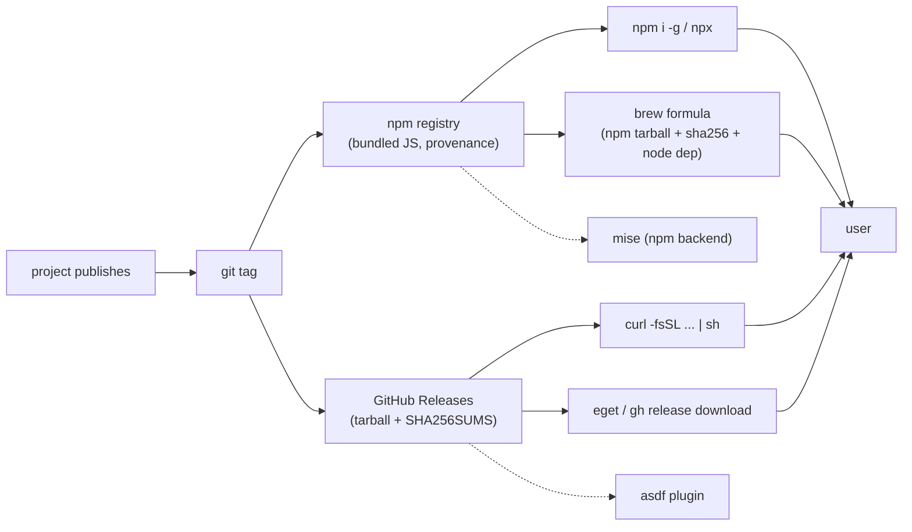

# Install landscape — and the proposal for whl

> [!tip] TL;DR — the proposal
> **npm-first, tap-second, script-when-binary.**
> 1. Publish `whitehartlane` to npm with `bin.whl`, **bundled to plain JS** (kills the `--experimental-strip-types` Node gate) — `npm i -g whitehartlane`, zero-install trial via `npx whitehartlane`. Signed via npm provenance/trusted publishing.
> 2. Add a **`whl doctor`** command: whl composes herdr + opencode/pi + node, and no install channel can check those — only the tool itself can.
> 3. Self-hosted **Homebrew tap `yyx462/tap`** (macOS-only status makes brew the native channel; the npm-tarball formula pattern is 8 lines).
> 4. curl-one-liner + GitHub Releases **only when whl ships as a single file or binary** — the famous-dev signature move is a release-artifact pattern, and whl isn't there yet.
> No `whl upgrade` initially — the verified community contract is that self-update belongs to the *installer*, not the binary.

---

## The landscape at a glance

Survey of how respected CLIs (uv, bun, deno, opencode, jj, fzf, ollama, claude-code) actually let users install. Full verified detail per channel, with primary-source citations, lives in the cross-project knowledge base: `Agentic-Workspace/kb · research/install-channels-research.md` — the `§` references below point at its sections.



## The channel catalogue

| Channel | Shape | Famous users | Fit for a JS CLI like whl |
|---|---|---|---|
| **npm global / npx** | `npm i -g <pkg>`, `npx` trial | opencode, Gemini CLI, Claude Code, Biome, esbuild | **the native channel** — whl is already a Node program |
| **curl \| sh installer** | downloads release tarball, verifies, installs to `~/.local/bin` | rustup, bun, deno, uv, pnpm, ollama, Homebrew, opencode, Claude Code, herdr | premature until whl ships a single-file/binary artifact |
| **GitHub Releases + eget** | per-platform assets + `.sha256`, `eget yyx462/whitehartlane` | jj, fzf, bun; eget documents the asset-naming contract maintainers should follow | same precondition as the script |
| **Homebrew tap → core** | formula pins npm tarball URL + `sha256`, `depends_on "node"`, symlink bins | prettier (core, the model formula); opencode runs its own tap and *recommends it over core* | **strong second channel** — whl is macOS-only today |
| **Language-native installers** | `pipx`/`uv tool`, `cargo install`, `go install` | jj (cargo), uv (pipx), eget (go) | npm global is the JS equivalent — already covered |
| **Version managers** | mise / asdf / Volta / proto | herdr + opencode + fzf all document mise officially | free: mise installs npm packages natively — nothing to build |
| **Distro repos / snap / flatpak / winget** | OS-level packaging | jj, fzf, Claude Code (apt/dnf/apk) | skip — whl is macOS-only, GUI-less |

## The "interesting packaging helpers" famous devs use

This is the part the user asked about — the open-source helper layer under the famous install pages:

| Helper | What it does | Who leans on it |
|---|---|---|
| **goreleaser** | from one git tag: cross-build, archives, checksums, signing, and *publishes to taps/Scoop/Nix/npm* | fzf ships a `.goreleaser.yml` at repo root |
| **eget** | installs prebuilt binaries from GitHub Releases; auto-verifies `.sha256` companions; publish docs literally say "you can list eget as a one-line method" | the Releases ecosystem |
| **webi (webinstall.dev)** | shared `curl https://webi.sh/<pkg> \| sh` installer network, official-source downloads into `~/.local` | dozens of tools plug in |
| **cargo-dist** | tag → tarballs + installer scripts + CI workflow, machine-readable manifest | Rust release engineering (famous adopters **unverified** — see research file) |
| **nfpm** | deb/rpm/apk from one YAML, no external deps | the engine *inside* goreleaser |
| **esbuild/tsdown bundling** | bundle TS→single JS before publishing: smaller download, no loader cost, down-leveled syntax | the documented npm-publish pattern; tsup is unmaintained → tsdown |
| **mise backends** | one tool manager sourcing npm/cargo/github releases | herdr, opencode, fzf list it as official |

> [!note] The convergent patterns
> 1. Famous CLIs offer **4–8 channels**, but doc *order* tells the truth: binary tools lead with curl-scripts; JS tools lead with npm.
> 2. Modern TS CLIs **don't ship loose TS**: Claude Code's npm package wraps a native binary; esbuild swaps its shim for a compiled binary; the converged pattern is *bundle to one file* or *compile to one binary*.
> 3. **Self-update belongs to the installer.** bun/uv/herdr/Biome all say it: detect the channel or defer to the package manager. `gh` ships no self-update at all.
> 4. **Trust is now CI-cheap**: npm provenance + trusted publishing (Sigstore, tokenless), GitHub artifact attestations (`gh attestation verify`), formula `sha256` pins.

## whl's constraints (verified in-repo)

| Fact | Consequence | Source |
|---|---|---|
| Ships raw TS via `#!/usr/bin/env -S node --experimental-strip-types` | npm `engines` is a *soft* gate (npm prints `EBADENGINE` and installs anyway — Claude Code documented exactly this); a raw-TS npm package would die at runtime on older Node. **Must bundle.** | `bin/whitehartlane`, kb §1 |
| deps: `smol-toml`, `typebox`, `@earendil-works/pi-coding-agent` | global installs resolve deps *unlocked* each install → reproducibility argues for bundling app code (and deciding dep vendoring at publish time) | `package.json` |
| macOS-only, needs **herdr + opencode or pi** | no channel replaces a dependency check → `whl doctor` | README |
| npm name `whitehartlane` **free**, CLI shim `whl` | rename ADR's whole point was ownability; publishing completes it | ADR 0011 |
| GitHub repo exists; **no CI, no releases, no README install section** | trusted publishing needs a GitHub Actions workflow — that's prerequisite ticket #1 | repo survey |
| Ecosystem precedent: herdr = curl+brew+mise channels; opencode = curl+npm+**self-hosted tap recommended over core** | whl's channels should mirror its deps' conventions | kb §11 |

## Options considered

| Option | Verdict | Why |
|---|---|---|
| **A. npm publish (bundled) + doctor + tap** | ✅ **proposed** | native channel, zero infra, name free, ecosystem-consistent; tap rides the npm artifact |
| **B. curl-script + Releases first** | ❌ for now | the famous move, but it presumes a single-file/binary artifact; whl would need SEA/bun-compile first — polish before substance |
| **C. brew-tap only** | ❌ alone | narrows to brew users; whl's audience already lives in npm-land (pi-coding-agent is an npm dep) |
| goreleaser / cargo-dist / nfpm | ❌ | built for compiled binaries & multi-OS — wrong tool for a bundled-JS macOS CLI |
| `whl upgrade` self-updater | ❌ initially | against the verified community contract; `whl doctor` prints the right per-channel upgrade command instead |

## The proposal — a four-stage ladder

```
Stage 0  (today, keep)   git clone + npm ci + ~/.local/bin symlink — the dev path
Stage 1  (do first)      npm publish whitehartlane: esbuild/tsdown bundle → plain JS,
                         bin.whl + bin.whitehartlane, engines pinned, files whitelist
                         (incl. web/ + plugin/ assets), tag → GitHub Release
Stage 2  (same PR set)   whl doctor — checks node, herdr, opencode|pi, PATH;
                         prints the channel-correct upgrade hint (no self-update)
Stage 3  (after v0.1)    brew tap yyx462/tap — formula: npm tarball URL + sha256
                         + depends_on "node" + libexec + install_symlink (prettier model);
                         submit to homebrew-core only once adoption exists
Stage 4  (only if)       curl one-liner + eget-ready Releases — gate: whl ships as
                         a single bundled file or SEA/bun-compiled binary
```

Trust checklist that comes almost free with Stage 1: GitHub Actions **trusted publishing** (tokenless, OIDC) → npm **provenance** auto-generated → users verify with `npm audit signatures`; brew formula pins the registry tarball's `sha256`; tags are the release trigger.

> [!warning] What Stage 1 does *not* fix
> Install is plumbing; whl's real contract is `whl run mismatch` needs herdr + a runner + a model. That's exactly why `whl doctor` is Stage 2 and not an afterthought — it's the install story for a tool whose dependencies are *tools*. It also matches the repo's own philosophy: the door is "a thin, honest shim" (`bin/whl` already refuses to run without `node_modules` — the doctor generalizes that honesty).

## Proposed ticket sequence (not filed)

1. **CI + trusted publishing** — `.github/workflows` release.yml: tag → bundle → test → `npm publish --provenance` (prerequisite for everything).
2. **Bundle the door** — esbuild/tsdown config, dist layout, `files:` whitelist, engines decision (≥20 vs ≥22) gated by deps.
3. **npm debut** — publish, README install section (`npm i -g whitehartlane` / `npx whitehartlane`), provenance verified.
4. **whl doctor** — dependency + channel detection, upgrade hint per channel.
5. **Tap** — `homebrew-tap` repo + formula against the npm tarball; README gains `brew install yyx462/tap/whitehartlane`.

---

*Every external claim above is verified against a primary source fetched 2026-10-15 — the citation trail lives in the kb repo (`Agentic-Workspace/kb · research/install-channels-research.md`). In-repo claims cite the files named. Nothing here was verified against a live npm publish (whl hasn't published); Stage 1 tickets are where that risk lands.*
